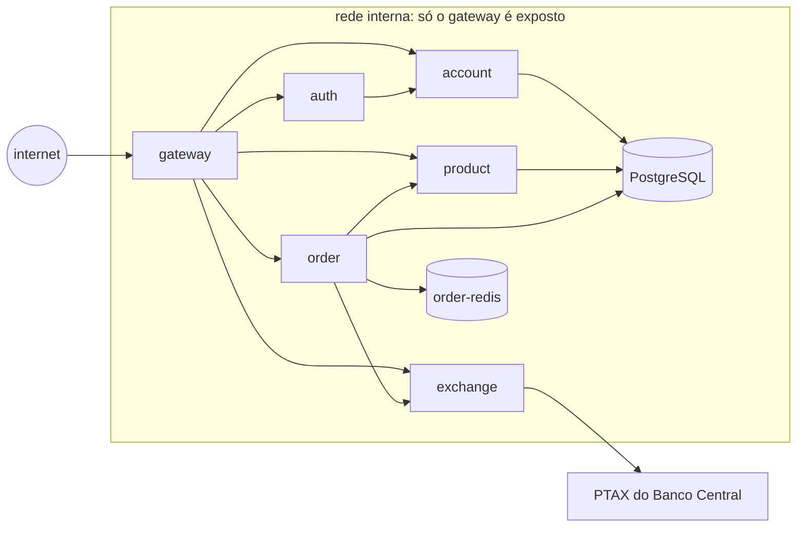
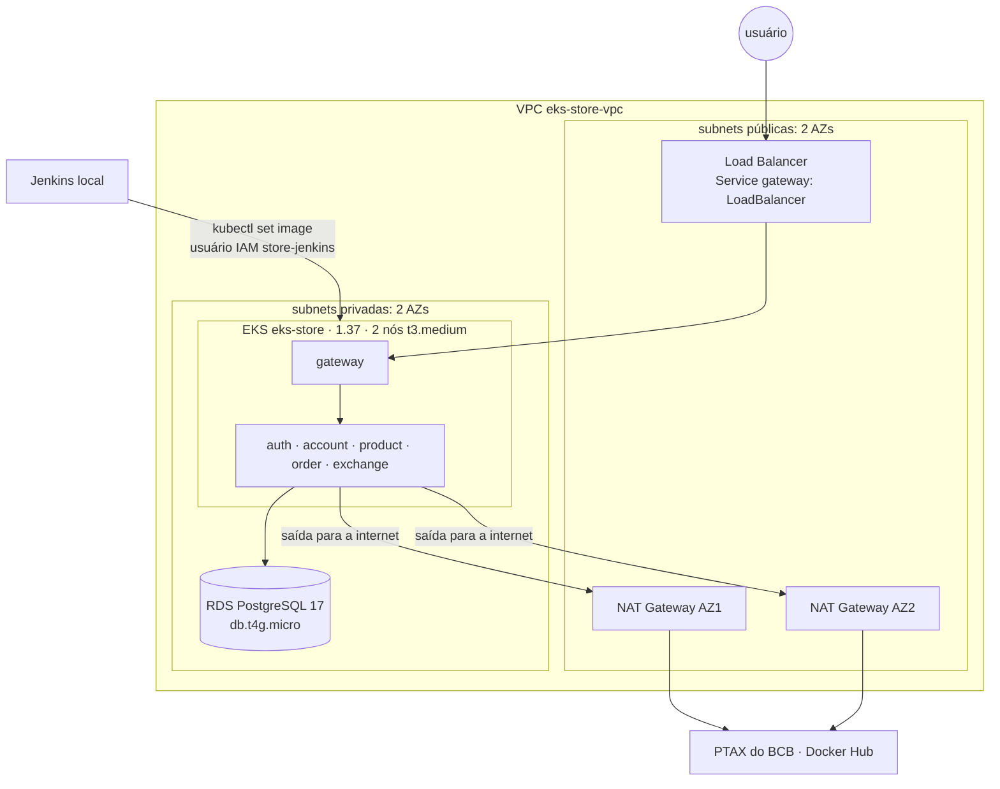

# Arquitetura

## Serviços

| Serviço | Linguagem | Porta | Banco | Chama |
|---|---|---|---|---|
| gateway | Java (Spring Cloud Gateway) | 8080 (único exposto) | — | auth (`/auth/solve`) e roteia o resto |
| auth | Java | 8080 | — | account |
| account | Java | 8080 | schema `accounts` | — |
| product | Java | 8080 | schema `products` | — |
| order | Java | 8080 (+ 8081 métricas) | schema `orders` + Redis | product, exchange |
| exchange | Python (FastAPI) | 8080 | — | PTAX (API externa) |

Regras que todos os serviços seguem:

- nome do Service no Kubernetes (e no compose) igual ao do serviço, sempre na porta **8080**;
- `GET /<serviço>/health-check` responde 200 sem expor nada interno, e as probes do Kubernetes
  chamam esse endpoint;
- identidade só pelos headers `id-account`/`id-role` vindos do gateway;
- segredos (chave do JWT, seed do admin, senha do banco) só em `.env` local ou Secret do
  Kubernetes, nunca no Git.

## Na AWS

Tudo em **us-east-2 (Ohio)**, criado por CloudFormation (`aws/*.yaml`) a partir do script
`aws/up.ps1`, com a tag `project=store-pma`.

| Stack (CloudFormation) | O que cria |
|---|---|
| `eks-store-vpc` | VPC com 2 subnets públicas e 2 privadas, 2 NAT Gateways |
| `eks-store-iam` | roles do cluster e dos nós |
| `eks-store-cluster` | cluster EKS + node group (2 × t3.medium, 20 GB, mín. 1, máx. 4) + metrics-server |
| `eks-store-rds` | RDS PostgreSQL 17, `db.t4g.micro`, 20 GB gp3, Single-AZ, privado |
| `eks-store-jenkins-iam` | usuário IAM do Jenkins (permanente) |
| `eks-store-jenkins-access` | access entry do Jenkins no cluster (só o namespace `default`) |

- Os nós e o RDS ficam nas **subnets privadas**: só o Load Balancer tem endereço público. O RDS
  só aceita conexões dos nós do cluster (security group).
- Os pods saem para a internet pelos NAT Gateways: é por eles que os nós baixam as imagens do
  Docker Hub e o Exchange consulta o PTAX.
- O Jenkins não tem acesso de administrador: o usuário IAM `store-jenkins` só descreve o cluster
  e edita o namespace `default`.
