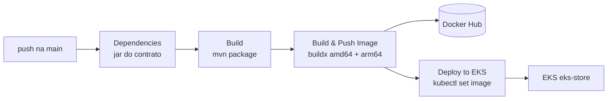
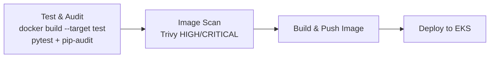

# CI/CD (Jenkins)

Página da disciplina: [CI/CD](https://insper.github.io/platform/2026.2/exercises/project/ci-cd/).
Um job **Pipeline** por serviço ("Pipeline script from SCM", branch `*/main`, `Jenkinsfile` na
raiz do repo). O Jenkins roda em Docker (`store-pma/jenkins/compose.yaml`), com Maven, Docker CLI,
`kubectl` e AWS CLI.



| Estágio | O que faz |
|---|---|
| `Dependencies` | `build job: 'product'` (e `order`): instala o jar do contrato que o service usa |
| `Build` | `mvn -B clean package` (o Order roda os testes aqui) |
| `Build & Push Image` | `docker buildx` multi-plataforma; tags `latest` e `<BUILD_ID>` |
| `Deploy to EKS` | com a credencial `aws-credential`: `kubectl set image` + `rollout status`; pula sem falhar se o cluster estiver desligado |

O pipeline do **Exchange** é diferente: não tem Maven, e o Jenkins não tem Python. Os testes e a
varredura rodam dentro do `docker build`:



Se um teste falhar, se uma dependência tiver vulnerabilidade conhecida ou se a imagem tiver
vulnerabilidade HIGH/CRITICAL com correção disponível, a imagem **não é publicada** (ver
[Bottlenecks](bottlenecks.md#2-varredura-de-vulnerabilidades-no-pipeline)).

## Credenciais no Jenkins

| ID | Tipo | Para quê |
|---|---|---|
| `dockerhub-credential` | usuário + token Read & Write | push das imagens |
| `github-credential` | usuário + token | checkout (evita limite da API) |
| `aws-credential` | access key do usuário IAM `store-jenkins` | deploy no EKS |

O usuário IAM `store-jenkins` só pode `eks:DescribeCluster`. Dentro do cluster, ele tem
`AmazonEKSEditPolicy` **só no namespace `default`**: menor privilégio possível para um deploy.

## Evidências (12/11/2026)

Builds `#2` de account, auth, product e gateway, com deploy no EKS:

```text
#12 pushing manifest for docker.io/pedrohmm1/gateway:2 2.5s done
deployment.apps/gateway image updated
deployment "gateway" successfully rolled out
Finished: SUCCESS
```

## Deploy sem derrubar a API (readinessProbe)

Medido com 1 requisição/s pelo Load Balancer durante o rollout:

| Configuração | Resultado |
|---|---|
| sem `readinessProbe` | ~40 s de HTTP 503 enquanto o Spring iniciava |
| com `readinessProbe` | gateway: 90 × 200; product: 89 × 200 e 1 requisição cortada |

O Order e o Exchange usam `httpGet` em `GET /<serviço>/health-check`, como o site pede.
Gateway, Auth, Account e Product usam `tcpSocket` na 8080 (a porta só abre no fim da
inicialização do Spring).
