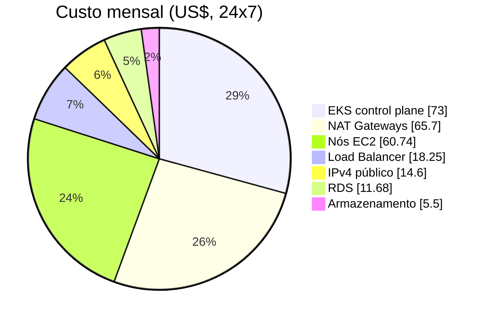

# Custos, PaaS e SLA

Página da disciplina: [Costs & PaaS](https://insper.github.io/platform/2026.2/exercises/project/costs/).
Os recursos abaixo são os que o `aws/up.ps1` cria de fato (templates em `store-pma/aws/`).

## Recursos e custo por hora

Preços **on-demand** em **us-east-2 (Ohio)**, conferidos nos arquivos públicos da AWS Price List
(`pricing.us-east-1.amazonaws.com/offers/v1.0/aws/<serviço>/current/us-east-2/index.json`)
em 18/11/2026[^1].

| Recurso | Quantidade | Preço unitário | US$/hora | US$/mês (730 h) |
|---|---|---|---|---|
| EKS control plane (Kubernetes 1.37, suporte padrão) | 1 cluster | 0,10/h | 0,1000 | 73,00 |
| Nós EC2 `t3.medium` (2 vCPU, 4 GiB) | 2 | 0,0416/h | 0,0832 | 60,74 |
| NAT Gateway (um por AZ) | 2 | 0,045/h[^2] | 0,0900 | 65,70 |
| IPv4 público (2 dos NAT + 2 do Load Balancer) | 4 | 0,005/h | 0,0200 | 14,60 |
| Classic Load Balancer (Service `gateway`) | 1 | 0,025/h | 0,0250 | 18,25 |
| RDS PostgreSQL `db.t4g.micro`, Single-AZ | 1 | 0,016/h | 0,0160 | 11,68 |
| EBS gp3 dos nós (2 × 20 GB) | 40 GB | 0,08/GB-mês[^2] | 0,0044 | 3,20 |
| Armazenamento do RDS (gp3) | 20 GB | 0,115/GB-mês[^2] | 0,0032 | 2,30 |
| **Total fixo** | | | **≈ 0,342** | **≈ 249,50** |

Variáveis, pequenos no volume do projeto: processamento do NAT (US$ 0,045/GB), do Load Balancer
(US$ 0,008/GB) e saída para a internet (100 GB/mês grátis). Imagens vêm do Docker Hub (sem ECR)
e não há custo de licença: tudo é open source.

[^1]: EKS, EC2, IPv4, Load Balancer e instância do RDS saíram dos arquivos públicos de preço da
    AWS para `us-east-2`.
[^2]: NAT Gateway, EBS e armazenamento do RDS: preço de lista da página de preços da AWS
    (ficam no arquivo de preços do EC2, de 440 MB, que não foi baixado).

**Leitura:** mais da metade do custo (EKS + NAT, 56%) é infraestrutura fixa que não depende da
carga. Os nós, onde a aplicação de fato roda, são só 24%.

## Quanto o projeto custou

O ambiente **não fica ligado**: o grupo sobe com `up.ps1` (~30 min), testa e derruba com
`down.ps1` (~20 min). Cada hora no ar custa ~US$ 0,34; um dia inteiro, ~US$ 8,20.

| Uso | Horas | Custo |
|---|---|---|
| Uma sessão de teste (subir, testar 1 h, derrubar) | ~2 h | ~US$ 0,70 |
| Exemplo: 10 sessões de ~2,5 h | ~25 h | ~US$ 8,50 |
| Se tivesse ficado ligado o mês todo | 730 h | ~US$ 250 |

!!! tip "Valor real"

    O valor cobrado de fato está no **Cost Explorer** da conta do grupo (filtro pela tag
    `project=store-pma`, região us-east-2). Ele inclui frações de hora e tráfego que a
    estimativa não pega.

## Como ficaria mais barato

| Mudança | Economia/mês | Custo |
|---|---|---|
| 1 NAT Gateway em vez de 2 | −US$ 36,50 (NAT + IPv4) | se a AZ do NAT cair, os pods perdem a saída para a internet |
| Nós Graviton `t4g.medium` (US$ 0,0336/h) | −US$ 11,68 | nenhum: as imagens já são publicadas para `amd64` e `arm64` |
| Nós Spot | tipicamente 50–70% dos nós | o nó pode ser retomado pela AWS com 2 min de aviso |
| Ligar só em horário de uso | proporcional às horas | é o que o projeto já faz com `up.ps1`/`down.ps1` |
| Savings Plan de 1 ano (produção) | desconto nos nós | compromisso de uso por 1 ano |

Com as duas primeiras, que não mudam nada no código, o ambiente 24x7 cai de ~US$ 250 para
~**US$ 201/mês** (−19%).

## PaaS: o que usamos e as alternativas

| Peça | Hoje | Modelo |
|---|---|---|
| Banco | RDS (backup, patch e failover são da AWS) | **PaaS** |
| Orquestração | EKS: a AWS opera o control plane, o grupo opera nós, manifestos e deploy | CaaS (Kubernetes gerenciado) |
| Imagens | Docker Hub público | SaaS |
| CI/CD | Jenkins no PC de um integrante | self-hosted |

Alternativas para os serviços:

| Opção | Vantagem | Desvantagem para este projeto |
|---|---|---|
| **EKS** (escolhido) | portável (mesmo `k8s.yaml` no Minikube e na AWS), HPA, controle total | US$ 73/mês só do control plane; mais coisa para operar |
| ECS + Fargate | sem cluster nem nós para gerenciar; paga por vCPU/GB de cada task | específico da AWS; perde os manifestos Kubernetes do curso |
| App Runner / Elastic Beanstalk | PaaS de verdade: sobe a imagem e ele cuida de balanceamento e escala | menos controle de rede e de rede interna entre serviços |
| Render / Railway / Heroku | o mais simples de todos | fora da AWS; caro em escala; sem o RDS na mesma VPC |

**Conclusão:** para 6 serviços pequenos, um PaaS (App Runner ou Fargate) seria mais barato e
mais simples de operar. O EKS se justifica aqui pelo objetivo da disciplina (Kubernetes, HPA,
probes, deploy contínuo) e pela portabilidade: o mesmo manifesto roda no Minikube e na AWS.

## SLA

SLAs mensais publicados pela AWS para os serviços que a aplicação usa em série (se qualquer um
cair, a aplicação cai):

| Serviço | SLA |
|---|---|
| Amazon EKS (control plane) | 99,95% |
| Amazon EC2 (região, com nós em 2 AZs) | 99,99% |
| Elastic Load Balancing | 99,99% |
| Amazon RDS Single-AZ | **99,5%** |
| Amazon RDS Multi-AZ | 99,95% |

**Disponibilidade composta (serviços em série):**

$$
0{,}9995 \times 0{,}9999 \times 0{,}9999 \times 0{,}995 \approx 99{,}43\%
$$

Isso dá até **~4 h fora do ar por mês**. O elo fraco é o **RDS Single-AZ**. Com RDS Multi-AZ
(+US$ 11,68/mês na instância), a conta sobe para ~**99,88%** (~53 min/mês).

Riscos que o SLA da AWS não cobre:

- **réplica única:** cada serviço tem 1 pod (só o gateway escala com HPA). Se um nó cair, os pods
  dele são recriados no outro nó, com ~40 s de inicialização dos serviços Java;
- **PTAX (API externa):** não tem SLA. O Exchange mitiga com o cache: se o Banco Central cair,
  ele responde com a última cotação por até 24 h (ver [Bottlenecks](bottlenecks.md));
- **deploy:** a `readinessProbe` evita indisponibilidade durante o rollout.

**SLO proposto:** 99,5% ao mês para a arquitetura atual. Para 99,9%: RDS Multi-AZ, 2 réplicas por
serviço com `PodDisruptionBudget` e Cluster Autoscaler.
