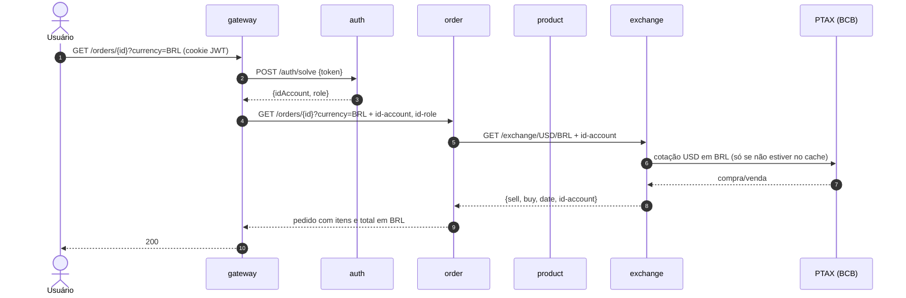

# Visão geral do projeto

O **store-pma** é uma aplicação web de compra e venda de produtos feita de microsserviços, como
pede a [página do projeto](https://insper.github.io/platform/2026.2/exercises/project/). Um
usuário se cadastra, faz login, vê a vitrine, cria pedidos e consulta o pedido convertido para
outra moeda.

- **Repositório root:** [EP-PC/store-pma](https://github.com/EP-PC/store-pma). Cada microsserviço é
  um **submódulo git** em `api/`, como o projeto exige ("the main project must incorporate the
  individual implementations on GitHub, as submodules").
- **Linguagens:** Java 25 + Spring Boot 4.1.1 / Spring Cloud 2025.1.3 (Gateway, Auth, Account,
  Product, Order) e Python 3.13 + FastAPI (Exchange).
- **Banco:** um PostgreSQL 17 (`store`), com **um schema por serviço** criado pelo Flyway
  (`accounts`, `products`, `orders`). Na AWS, é um RDS.
- **Ambientes:** Docker Compose (local), Minikube e **EKS na AWS** (us-east-2), com CI/CD pelo
  Jenkins.

## Fluxo de uma requisição

O **gateway** é a única porta de entrada. Ele valida o cookie `__store_jwt_token` no Auth
(`/auth/solve`) e repassa a identidade nos headers `id-account` e `id-role`, apagando os que o
cliente tente mandar. Nenhum outro serviço valida JWT: todos só leem esses headers.

## Páginas

- [Arquitetura](arquitetura.md): diagrama dos serviços e da AWS.
- [Serviços e endpoints](servicos.md): o que cada serviço expõe e as regras de acesso.
- [Exchange](exchange.md): o serviço que eu implementei.
- [Como rodar](como-rodar.md): compose, Minikube e EKS.
- [CI/CD](cicd.md), [Teste de carga](load-test.md), [Bottlenecks](bottlenecks.md) e
  [Custos, PaaS e SLA](custos.md).
